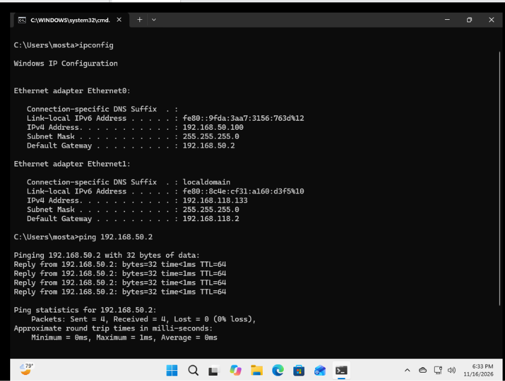
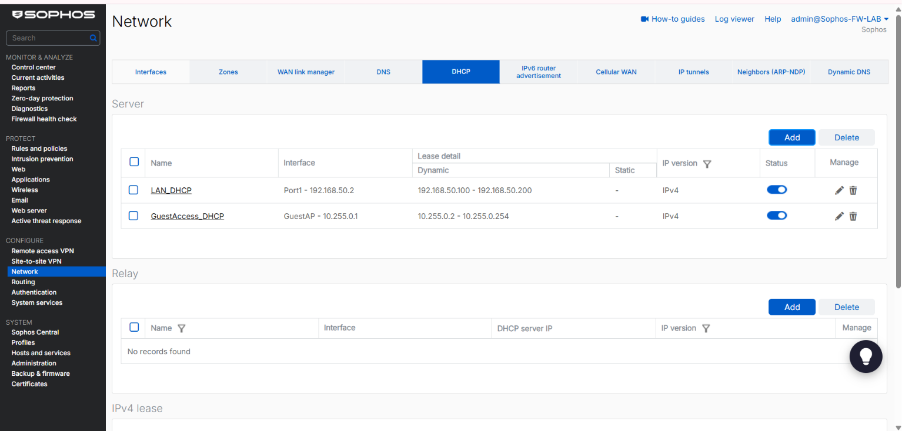
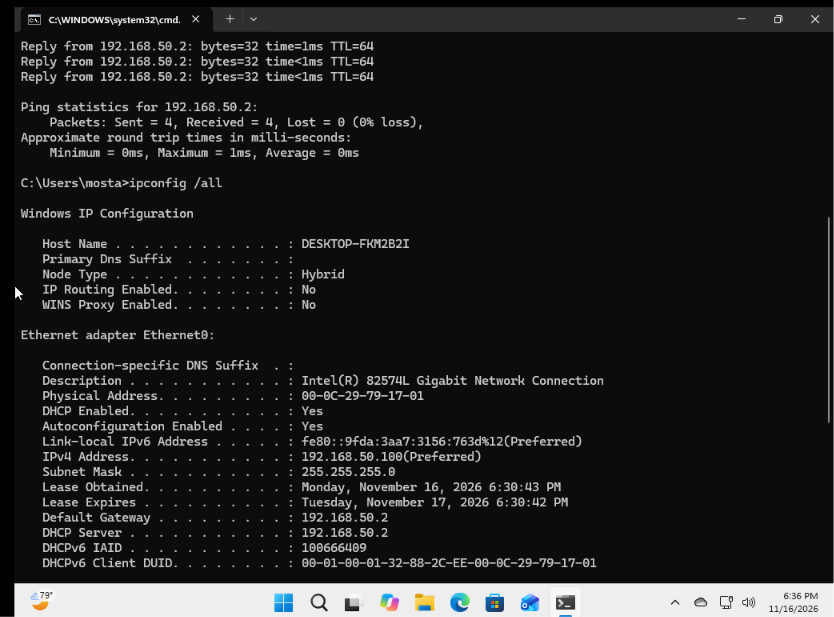
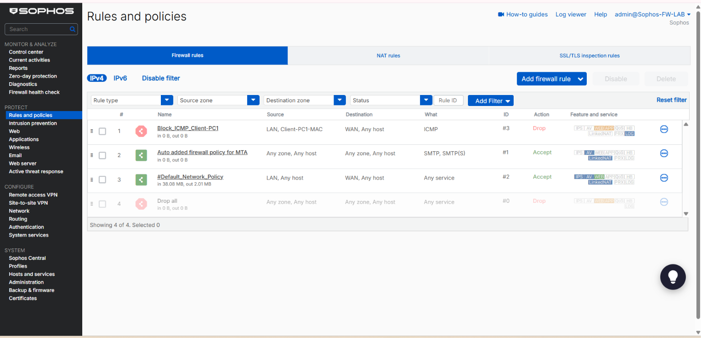
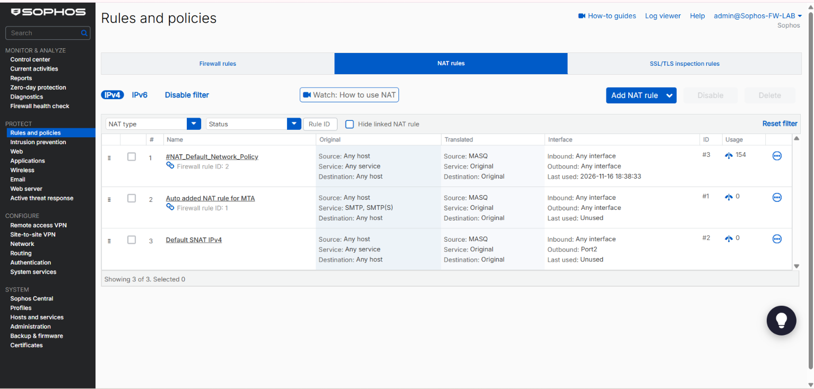
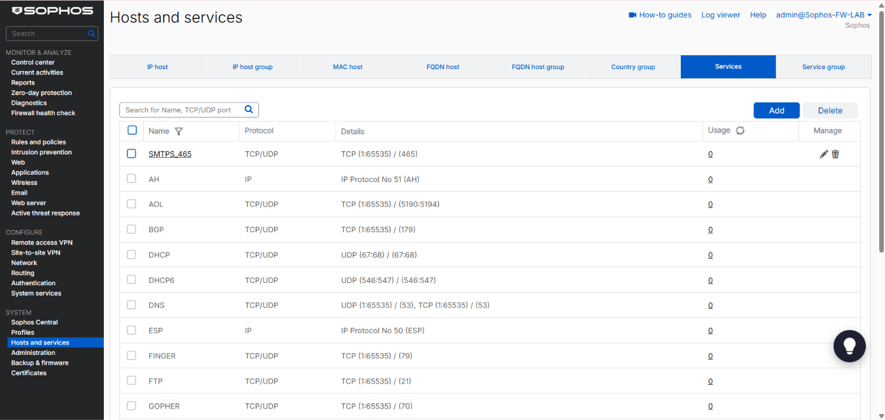
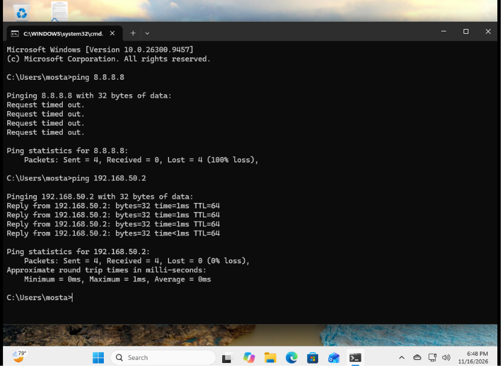

# Company Network Security Lab with Sophos Firewall

A hands-on lab that simulates a small company network protected by **Sophos Firewall (SFOS 22.0.3 MR-3)**, built on **VMware Workstation**. The project covers firewall administration, DHCP/DNS, NAT, custom firewall rules and real troubleshooting, and is documented step by step with screenshots.

## Repository Structure

```
sophos-firewall-lab/
├── README.md                      Project overview and results
├── LICENSE                        MIT license
├── .gitignore
├── screenshots/                   All proof screenshots
├── network-diagram/               Lab topology
└── docs/
    ├── phase1-dashboard-interfaces.md
    ├── phase2-client-vm.md
    ├── phase3-dhcp-dns.md
    ├── phase4-firewall-nat.md
    ├── phase5-web-filtering.md    (planned)
    ├── phase6-application-control.md (planned)
    ├── phase7-ips.md              (planned)
    ├── phase8-vpn.md              (planned)
    ├── phase9-logs-monitoring.md  (planned)
    └── troubleshooting/
        └── wan-gateway-down.md
```

Detailed notes for each phase are in the [docs](docs) folder.

## Project Status

| Phase | Topic | Status |
|---|---|---|
| 1 | Dashboard and interface verification | Done |
| 2 | Windows 11 client VM setup | Done |
| 3 | DHCP and DNS | Done |
| 4 | Firewall rules and NAT | Done |
| 5 | Web filtering | Planned |
| 6 | Application control | Planned |
| 7 | Intrusion Prevention System (IPS) | Planned |
| 8 | VPN (remote access / site-to-site) | Planned |
| 9 | Logs, monitoring and troubleshooting | In progress |

## Lab Environment

| Component | Details |
|---|---|
| Hypervisor | VMware Workstation |
| Firewall | Sophos Firewall SFOS 22.0.3 MR-3 (virtual appliance) |
| Host OS | Windows 11 |
| Client | Windows 11 VM |

## Network Design

```
Windows 11 Client VM  (DHCP: 192.168.50.100-200)
          |
       VMnet2 (host-only)
          |
Sophos Port1  - LAN - 192.168.50.2/24 (static)
Sophos Port2  - WAN - 192.168.118.x/24 (DHCP from VMware NAT)
          |
       VMnet8 (NAT, gateway 192.168.118.2)
          |
       Internet
```

| Sophos Port | VMware Network | Zone | IP |
|---|---|---|---|
| Port1 | VMnet2 (host-only) | LAN | 192.168.50.2/24 (static) |
| Port2 | VMnet8 (NAT) | WAN | DHCP (192.168.118.0/24) |

> The physical host's Wi-Fi and routing were never modified. All testing is done from the client VM.


---

## Phase 1: Dashboard and Interface Verification

Reviewed the Control Center (CPU, memory, interfaces, uptime) and confirmed the Port1/Port2 zones and IP addresses.


## Phase 2: Windows 11 Client VM

Connected the client VM to VMnet2 and verified connectivity to the firewall LAN interface.




## Phase 3: DHCP and DNS

- Verified DNS servers (8.8.8.8, 1.1.1.1).
- Created a DHCP server `LAN_DHCP` on Port1 (range 192.168.50.100 to 192.168.50.200, gateway and DNS 192.168.50.2).
- Verified the client received its IP, gateway and DNS automatically.




## Phase 4: Firewall Rules and NAT

Analyzed the default rules:

| Rule | Source to Destination | Action |
|---|---|---|
| #Default_Network_Policy | LAN to WAN, any service | Accept |
| Drop all | Any to Any | Drop (default deny) |

NAT rule `#NAT_Default_Network_Policy` masquerades LAN traffic behind the WAN IP.





### Custom rule: block ICMP from one client

Created a MAC-based host object (`Client-PC1-MAC`) so the rule follows the device even when its DHCP address changes. Then created `Block_ICMP_Client-PC1` (LAN to WAN, service ICMP, action Drop) at the top of the rule list, because Sophos evaluates rules from top to bottom.

**Result:** ping to the internet was dropped, while browsing and DNS continued to work. The Drop entry was confirmed in the firewall log.





---

## Troubleshooting Case: No Internet from the Client

**Symptom:** The client could ping the firewall (192.168.50.2) but not 8.8.8.8, and DNS lookups timed out.

**Diagnosis:**
1. Client to firewall worked, so LAN and DHCP were fine.
2. Pinging 8.8.8.8 does not need DNS, so DNS was not the root cause.
3. From the firewall (Diagnostics > Tools), ping to 8.8.8.8 also failed.
4. The WAN gateway 192.168.118.2 showed red and did not answer ping, so the fault was on the VMware NAT side.

**Fix:** Restarted the VMware NAT Service and VMware DHCP Service on the host. The gateway turned green and the client reached the internet.


**Lesson:** Test layer by layer (client, firewall, gateway, internet) to find where the path breaks.

---

## Skills Demonstrated

- Sophos Firewall administration (interfaces, zones, DHCP, DNS)
- Firewall rule order and default-deny design
- NAT / masquerading
- MAC-based host objects for DHCP environments
- Log analysis and layered network troubleshooting
- Technical documentation

## Roadmap

- [ ] Web filtering policies and categories
- [ ] Application control
- [ ] IPS configuration and attack testing
- [ ] Remote access VPN and site-to-site VPN
- [ ] Log monitoring and reporting

## License

Released under the [MIT License](LICENSE).

## Author

Add your name and LinkedIn link here.
