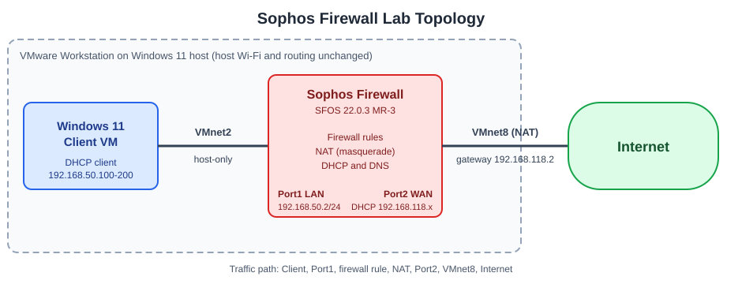
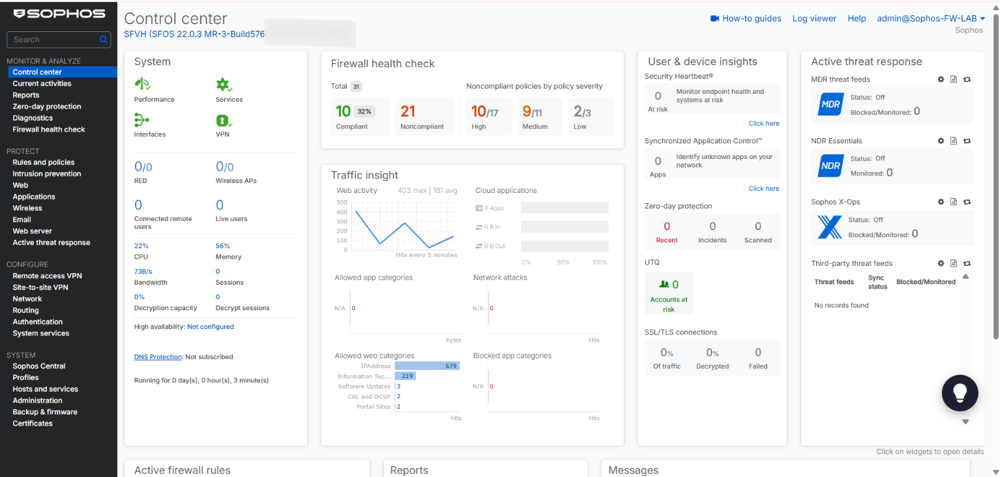
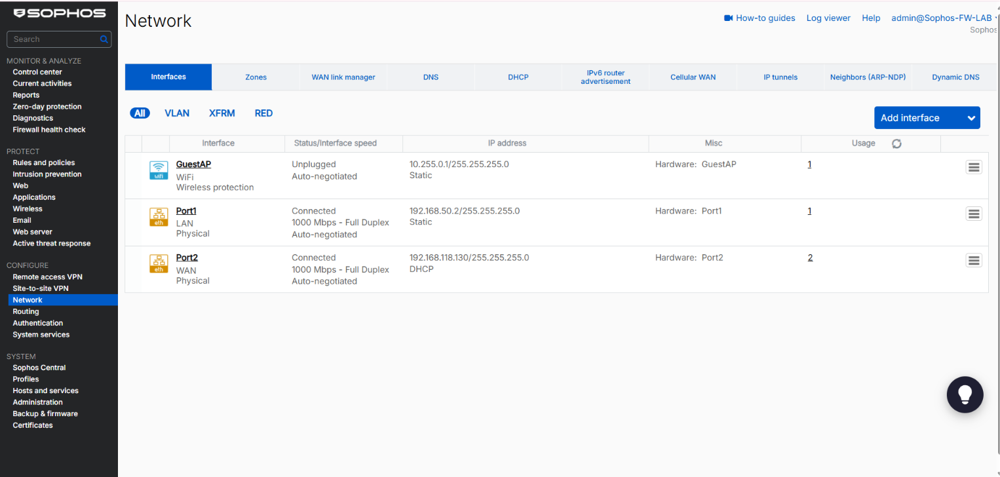
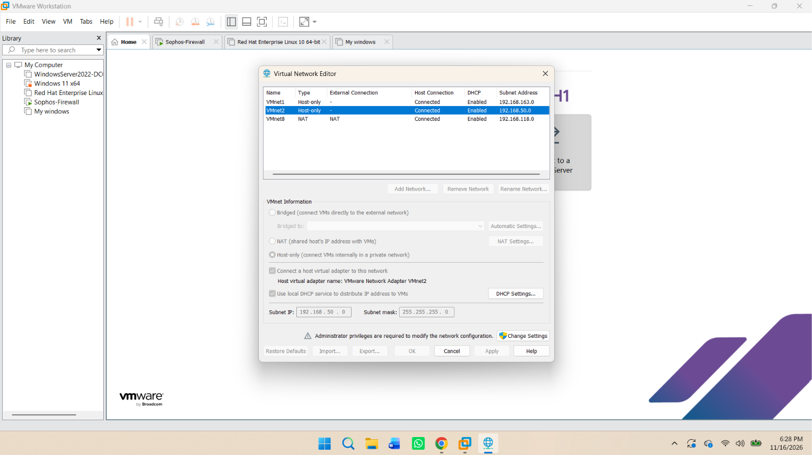
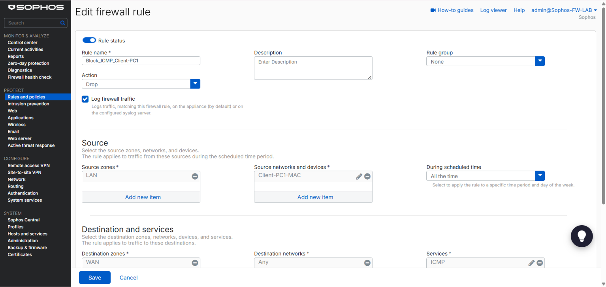
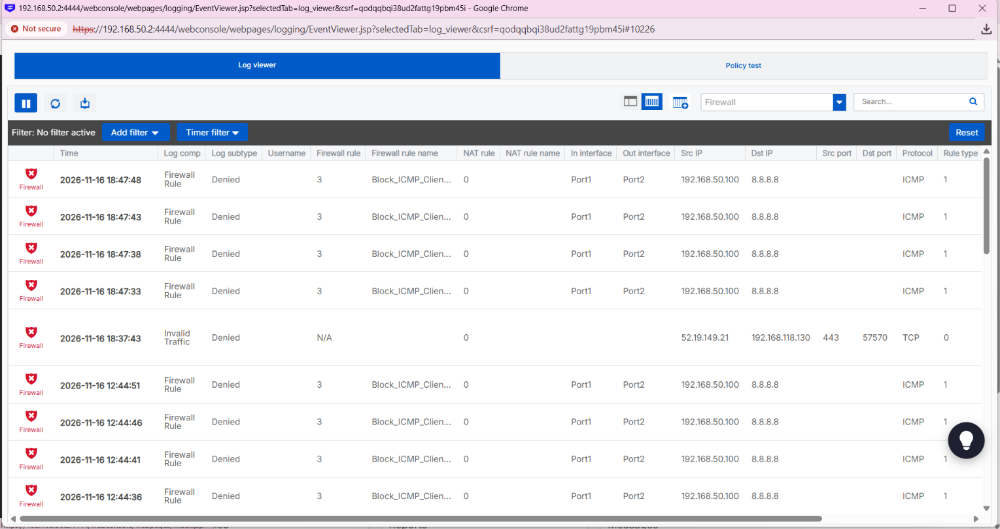

# Company Network Security Lab with Sophos Firewall


A hands-on lab that simulates a small company network protected by **Sophos Firewall**, built on **VMware Workstation**. I built it step by step to learn firewall administration, and every phase is documented with screenshots, results and the problems I solved.



## Contents

- [Key results](#key-results)
- [Project status](#project-status)
- [Lab environment](#lab-environment)
- [Phase walkthrough](#phase-walkthrough)
- [Troubleshooting case](#troubleshooting-case-no-internet-from-the-client)
- [Skills demonstrated](#skills-demonstrated)
- [Repository structure](#repository-structure)
- [Roadmap](#roadmap)

## Key results

| What | Outcome |
|---|---|
| Network design | Separate LAN (Port1) and WAN (Port2) zones with a client VM behind the firewall |
| DHCP | Created `LAN_DHCP` so clients receive IP, gateway and DNS automatically |
| Internet access | Client reaches the internet through firewall rule and NAT, confirmed with ping and browsing |
| Custom firewall rule | Blocked ICMP from one client using a MAC-based host, verified in the firewall log |
| Troubleshooting | Found and fixed a down WAN gateway by testing layer by layer |

## Project status

| Phase | Topic | Status |
|---|---|---|
| 1 | Dashboard and interface verification | Done |
| 2 | Windows 11 client VM | Done |
| 3 | DHCP and DNS | Done |
| 4 | Firewall rules and NAT | Done |
| 5 | Web filtering | Planned |
| 6 | Application control | Planned |
| 7 | Intrusion Prevention System (IPS) | Planned |
| 8 | VPN | Planned |
| 9 | Logs, monitoring and troubleshooting | In progress |

## Lab environment

| Component | Details |
|---|---|
| Hypervisor | VMware Workstation |
| Firewall | Sophos Firewall SFOS 22.0.3 MR-3 (virtual appliance) |
| Host OS | Windows 11 |
| Client | Windows 11 VM |

| Sophos port | VMware network | Zone | IP |
|---|---|---|---|
| Port1 | VMnet2 (host-only) | LAN | 192.168.50.2/24 (static) |
| Port2 | VMnet8 (NAT) | WAN | DHCP (192.168.118.0/24) |

The physical host's Wi-Fi and routing were never modified. All testing is done from the client VM so the host's own internet is not routed through the firewall. See [docs/lab-setup.md](docs/lab-setup.md) to rebuild the lab.

## Phase walkthrough

### Phase 1: Dashboard and interfaces
Reviewed the Control Center and verified zones and IP addresses. Details: [docs/phase1-dashboard-interfaces.md](docs/phase1-dashboard-interfaces.md)




### Phase 2: Windows 11 client VM
Connected the client to VMnet2 only, so all its traffic must pass through Sophos. Details: [docs/phase2-client-vm.md](docs/phase2-client-vm.md)




### Phase 3: DHCP and DNS
Created a DHCP server on Port1 (192.168.50.100 to 192.168.50.200, gateway and DNS 192.168.50.2). Details: [docs/phase3-dhcp-dns.md](docs/phase3-dhcp-dns.md)


### Phase 4: Firewall rules and NAT
Analyzed the default rules (LAN to WAN accept, Drop all as default deny) and the masquerade NAT rule, then created a custom rule. Details: [docs/phase4-firewall-nat.md](docs/phase4-firewall-nat.md)

| Rule | Source to Destination | Action |
|---|---|---|
| #Default_Network_Policy | LAN to WAN, any service | Accept |
| Block_ICMP_Client-PC1 (custom) | LAN (Client-PC1-MAC) to WAN, ICMP | Drop |
| Drop all | Any to Any | Drop |






I used a **MAC host** instead of an IP because the client gets its address from DHCP, so an IP-based rule could later hit the wrong computer.

## Troubleshooting case: no internet from the client

**Symptom:** The client pinged the firewall but not 8.8.8.8, and DNS timed out.

**Diagnosis:** Client to firewall worked. The firewall itself could not ping 8.8.8.8 or its WAN gateway (192.168.118.2), and the gateway showed red. The fault was on the VMware NAT side, not in the firewall rules or DNS.

**Fix:** Restarted VMware NAT Service and VMware DHCP Service on the host. The gateway turned green and the client got internet access.

Full write-up: [docs/troubleshooting/wan-gateway-down.md](docs/troubleshooting/wan-gateway-down.md)

## Skills demonstrated

- Sophos Firewall administration (interfaces, zones, DHCP, DNS)
- Firewall rule order and default-deny design
- NAT / masquerading
- MAC-based host objects in a DHCP environment
- Log analysis and layered network troubleshooting
- Technical documentation

More: [docs/interview-notes.md](docs/interview-notes.md) and [docs/command-cheatsheet.md](docs/command-cheatsheet.md)

## Repository structure

```
sophos-firewall-lab/
├── README.md
├── LICENSE
├── CHANGELOG.md
├── .gitignore
├── screenshots/               proof screenshots
├── network-diagram/           lab topology (SVG)
└── docs/
    ├── lab-setup.md           how to rebuild the lab
    ├── command-cheatsheet.md  commands and Sophos menu paths
    ├── interview-notes.md     questions and answers about this project
    ├── security-checklist.md  what to hide before publishing
    ├── phase1 to phase4       completed phase notes
    ├── phase5 to phase9       planned phases
    └── troubleshooting/
        └── wan-gateway-down.md
```

## Roadmap

- [ ] Web filtering policies and categories
- [ ] Application control
- [ ] IPS configuration and attack testing
- [ ] Remote access VPN and site-to-site VPN
- [ ] Log monitoring and reporting

## License

Released under the [MIT License](LICENSE).

## Author

**Mostafa Kamal Asif**
GitHub: [MostafaKamalAsif](https://github.com/MostafaKamalAsif)
LinkedIn: add your link here
