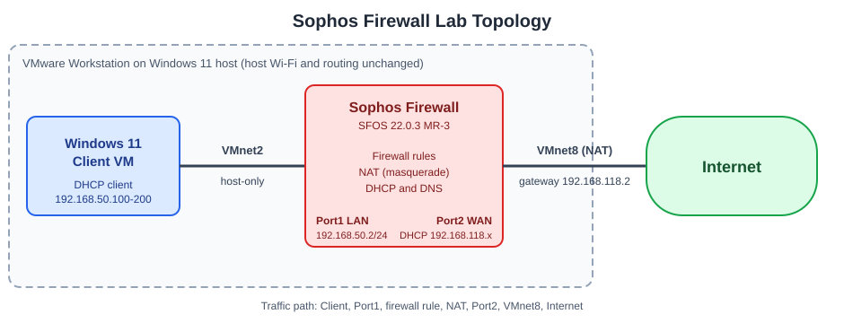

# Network Diagram

| Link | VMware network | Type | Subnet |
|---|---|---|---|
| Client to Sophos Port1 | VMnet2 | Host-only | 192.168.50.0/24 |
| Sophos Port2 to Internet | VMnet8 | NAT | 192.168.118.0/24 |

The editable source is `lab-topology.svg`. You can open it in draw.io, Inkscape or any text editor.
